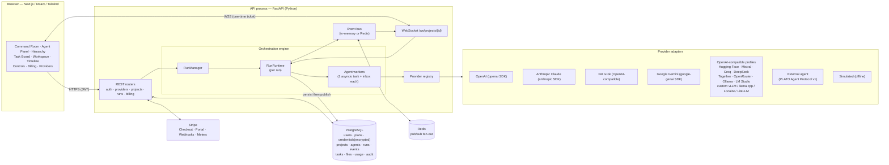

# PLATO — Architecture

> Multiple Minds. One Intelligence.

PLATO is a real-time command centre where AI agents from different providers work as one team
under human control. This document describes the system as **implemented** in this repository,
and marks clearly where a capability is designed-for but not yet built.

## 1. System diagram



## 2. Monorepo layout

```
plato/
├── backend/                 FastAPI app, orchestrator, adapters, tests
│   ├── app/
│   │   ├── main.py          app factory, lifespan (create tables, seed plans, recover runs)
│   │   ├── core/            config (env), security (bcrypt, JWT, Fernet, WS tickets), rate limiting
│   │   ├── db.py, models.py SQLAlchemy 2 async engine + schema
│   │   ├── schemas.py       request/response models (pydantic)
│   │   ├── plans.py         default plans + entitlement enforcement
│   │   ├── billing_meter.py optional Stripe Billing Meter reporting
│   │   ├── providers/       adapter contract + OpenAI, Anthropic, xAI, Gemini, External, Simulated
│   │   ├── orchestrator/    engine, event protocol + directive parser, prompts, bus, pricing
│   │   └── api/             routers: auth, providers, projects (+agents, files), runs, billing, ws
│   ├── tests/               45+ pytest tests incl. wire-level provider tests against a fake upstream
│   └── scripts/live_demo.py §10 demo against LIVE OpenAI + Anthropic
├── frontend/                Next.js 16 App Router + Tailwind; installable PWA
│   ├── src/app/             /login, / (projects), /projects/[id], /providers, /billing, manifest.ts
│   ├── src/components/      AppShell, Brand, Pwa (service worker + Install app), project/*
│   ├── src/lib/             api client (runtime API URL), live stream hook, types
│   ├── public/              sw.js (service worker), offline.html, icons/
│   └── e2e/demo.e2e.cjs     Playwright end-to-end demo check
├── cli/                     `plato` terminal client (Python; Windows/macOS/Linux; PowerShell-friendly)
├── scripts/                 install.sh / start.sh (macOS, Linux, Kali, ChromeOS) · install.ps1 / start.ps1 (Windows)
├── deploy/Caddyfile         single-origin HTTPS reverse proxy (phones, remote access)
├── docs/                    this file, PROTOCOL, DEPLOYMENT, PLATFORMS, STATUS
├── docker-compose.yml       postgres + redis + api + web
└── .env.example
```

## 3. Core concepts

| Concept | Meaning |
|---|---|
| **Commander** | The human user. Owns every project, agent, key and run in their tenant. |
| **Primary agent** | Agent with no parent. Receives the objective at kickoff. |
| **Subagent** | Agent with `parent_id` (max depth 2). Idle until delegated a task (or explicitly assigned). |
| **Configured agent** | A saved agent definition — counted against plan `max_agents`. |
| **Executing agent** | An agent currently generating — bounded by plan `max_concurrent_agents` (a semaphore per run). |
| **Run** | One execution of the team against an objective, with its own limits, budget and event log. |
| **Event** | Append-only record of everything that happened in a run (`events` table, per-run `seq`). |
| **Directive** | Structured instruction an agent embeds in its reply: `<message>`, `<task>`, `<done>`. |

## 4. Orchestration engine (`app/orchestrator/engine.py`)

**Concurrency model.** Each agent in a run has its own asyncio worker and inbox queue. Workers never
wait on each other — only on their own inbox — so agents run in parallel and react as soon as a
message arrives. A per-run semaphore caps simultaneous generations at the plan's concurrency limit.

**An agent turn:**
1. Drain the inbox (all pending items are batched into one user turn).
2. Wait on the run's pause gate; check the per-agent turn limit.
3. Stream a completion from the agent's adapter. Each token is published as an ephemeral
   `agent.delta` event; the in-flight text is kept for reconnect snapshots.
4. Record usage (tokens, estimated cost, billed-to) and enforce the USD budget.
5. Parse directives; check permissions (collaboration mode); route messages into recipients'
   inboxes; create tasks (optionally held for Commander approval).
6. `<done>` completes the agent's active tasks.

**Termination.** A run completes on *quiescence*: no agent busy, all inboxes empty, no task
awaiting approval. It ends early as `limit_reached` on: agent-to-agent message cap, per-agent
turn cap, wall-clock cap, USD budget, or exhausted platform credits; or `stopped` by the Commander.
Turns in flight at stop time are closed out as `agent.turn.interrupted` with their partial text.

**Loop prevention.** Every run is bounded four ways (messages, turns, seconds, dollars); plan
entitlements clamp what a project may request. Prompts tell agents not to send acknowledgements
and to finish with `<done>`.

**Error recovery.** Retryable provider errors (429, 5xx, connection) are retried twice with
exponential backoff, visible in the timeline. Non-retryable errors mark the agent `error`, fail
its active tasks and leave the rest of the team running. A crashed worker never takes down the run.

**Commander controls.** Message any subset of agents; pause (in-flight replies finish, no new
turns start); resume; interrupt one agent's current generation; stop the run; approve/reject
delegations. Available over both WebSocket and REST, audit-logged.

**Collaboration modes** (`prompts.py`): open discussion, structured delegation (hierarchical
permissions), parallel collaboration, debate, independent review (agent-to-agent messaging
disabled). Mode = prompt guidance + a communication policy enforced by the engine, not the model.

## 5. Provider integration

Two integration methods, distinguished in data (`agents.kind`) and UI:

* **Hosted agents** — PLATO calls a model API with the user's BYOK key (or a platform key
  that debits usage credits). Adapters use the official SDKs: `openai`, `anthropic`,
  `google-genai`.

| Category | Providers | Base URL | Key |
|---|---|---|---|
| Frontier labs | OpenAI, Anthropic Claude, xAI Grok, Google Gemini | fixed | required |
| Open models, clouds & routers | Hugging Face Inference Providers (`router.huggingface.co/v1`), Mistral, Groq, DeepSeek, Together AI, OpenRouter | fixed | required |
| Local & self-hosted | Ollama (`localhost:11434/v1`, or Ollama Cloud `ollama.com/v1`), LM Studio (`localhost:1234/v1`) | default, overridable | optional |
| Custom | any OpenAI-compatible server: vLLM, llama.cpp server, LocalAI, TGI, LiteLLM proxy… | required | optional |

Everything except Anthropic and Gemini goes through one `OpenAICompatibleAdapter` configured by a
`CompatProfile`: `max_completion_tokens` (OpenAI, xAI) vs `max_tokens` (everyone else), and whether
to request `stream_options.include_usage` (only where documented: OpenAI, xAI, Ollama). Usage is
read from any chunk that carries it (including Groq's `x_groq.usage`); if a server reports none,
tokens are estimated (~4 chars/token) and flagged `tokens_estimated`. Self-hosted runtimes are
billed `self_hosted` at $0; the custom server is costed (it may front a paid API).

A saved *connection* (`provider_credentials`) holds an encrypted key and/or a `base_url`. Every
user-supplied URL passes the SSRF guard (`core/netguard.py`): https + public addresses only, unless
private endpoints are allowed (default outside production).
* **Connected external agents** — a runtime the user operates (a local coding agent, an
  SDK-based agent service) that implements the small *PLATO External Agent Protocol v1*
  (docs/PROTOCOL.md §4). PLATO sends the conversation and streams back text.

PLATO does **not** assume access to private sub-agents inside consumer AI apps. Subagents in
PLATO are PLATO agents.

Adding a provider = implement `ProviderAdapter.stream()` + `list_models()` and register it in
`providers/registry.py`. The engine is untouched.

Anthropic specifics: Claude Opus 5.5 / Opus 5 / Fable 5.1 requests opt into Anthropic's
server-side refusal fallback (`fallbacks: "default"`, beta `server-side-fallback-2026-07-01`);
a `refusal` stop reason on any model surfaces as a non-retryable error.

## 6. Real-time delivery & persistence

* Persisted events are written to the DB **before** being published (under a per-run lock), so
  `seq` order is identical in the database and on the wire.
* Clients load history over REST (`GET /api/runs/{id}/events?after_seq=N`), then follow the
  WebSocket. On reconnect the server sends a `snapshot` (active runs, agent statuses, in-flight
  partial text) and the client gap-fills by `after_seq`. Refreshing the page loses nothing.
* The bus is in-memory by default; with `PLATO_REDIS_URL` it fans out through Redis pub/sub so any
  API instance can serve any WebSocket.
* **Current limitation:** a run executes inside the API process that started it. Controls for a
  run must reach that process; with several API replicas, use sticky sessions per project, or
  move execution to dedicated workers (planned: a Redis control channel + worker processes).
  Active runs cannot survive a process restart; on boot they are marked `interrupted`.

## 7. Database schema (`app/models.py`)

| Table | Key columns | Notes |
|---|---|---|
| `users` | email (unique), password_hash (bcrypt), plan_code, subscription_status, stripe ids, credits_usd, is_admin | |
| `plans` | code PK, price_usd_month, stripe_price_id, entitlements JSON | seeded; admin-editable |
| `provider_credentials` | owner_id, provider, label, encrypted_key (Fernet), key_hint, base_url, verified_at | a "connection"; unique(owner, provider, label); key never returned |
| `projects` | owner_id, name, shared_context, settings JSON (mode, limits, approvals) | |
| `agents` | owner_id, project_id, parent_id, name, role, instructions, kind, provider, model, credential_id, external_url | unique(project, name) |
| `runs` | owner_id, project_id, objective, mode, status, stop_reason, limits JSON, cost/tokens | |
| `events` | run_id, project_id, seq, type, agent_id, data JSON | unique(run_id, seq); append-only |
| `tasks` | run_id, title, description, assignee, creator (NULL = Commander), status, result | |
| `project_files` | project_id, path, content, shared_with_agents | DB-backed; S3 offload planned |
| `usage_records` | owner_id, run_id, agent_id, provider, model, tokens, cost_usd, cost_is_estimate, billed_to | billing source |
| `audit_logs` | owner_id, actor, action, target, details, ip | security & billing events |

Tables are created on startup (`create_all`); columns added since the first release are added in
place (`db._ADDITIVE_COLUMNS`). Alembic migrations are a Phase 5 item.

## 8. Security model

| Control | Implementation |
|---|---|
| Authentication | bcrypt (cost 12) passwords; HS256 JWT bearer tokens; WebSocket via 60-second single-use tickets (JWT never in URLs) |
| Tenant isolation | every row has `owner_id`; every lookup checks it and returns 404 on mismatch (tested) |
| Credentials | Fernet-encrypted at rest, verified with a live provider call, only a 4-char hint is ever returned; never placed in agent context |
| RBAC | Commander owns tenant; `is_admin` for plan administration; plan-gated features (hierarchies, external agents, audit logs). Team roles are Phase 5 |
| Human approval | optional approval gate for agent-delegated tasks |
| Spending limits | per-run USD budget, platform-credit balance, plan-clamped limits |
| Rate limiting | sliding-window per IP (auth), per user (run starts, WS actions) |
| Audit logging | auth, credentials, projects, agents, runs, controls, approvals, admin, Stripe |
| Prompt-injection controls | trust rules in every system prompt; teammate messages and files wrapped as `<agent_message>`/`<shared_file>` data; directive and envelope tags inside untrusted text are neutralised so injected text cannot forge senders or smuggle directives; recipients/permissions enforced by code, not the model |
| SSRF | user-supplied URLs (external agents, Ollama/LM Studio hosts, custom servers) must be https and public in production; private/loopback allowed in development or with `PLATO_ALLOW_PRIVATE_ENDPOINTS=true`; no credentials in URLs |
| Tool execution | agents have no tools that touch files, shells or networks in this version; sandboxed code execution is Phase 4 |
| Production guardrails | app refuses to boot in production with default secrets or with the simulated provider enabled |
