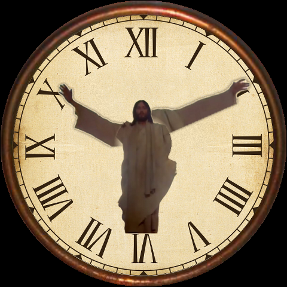
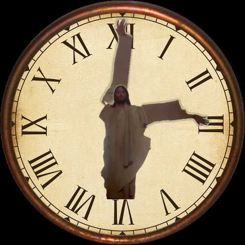
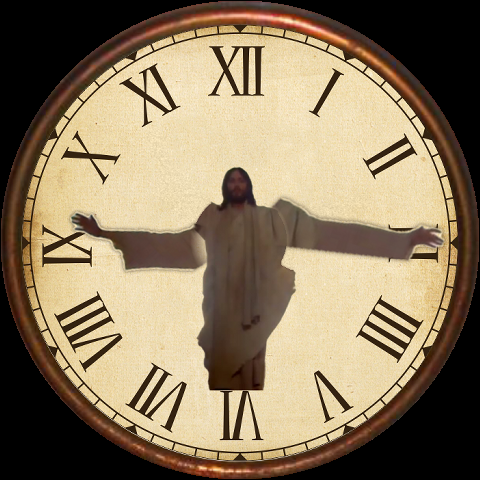
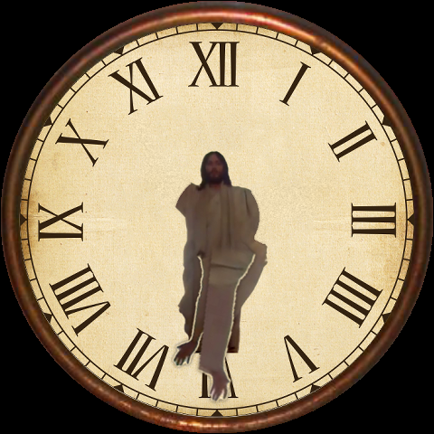
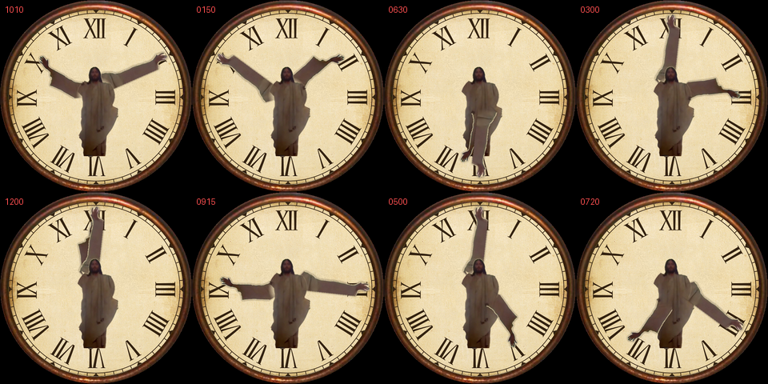

# Galaxy Watch6 Classic watch face — Jesus, arms as the hands

Built directly from the original clock image (`build/source_clock.png`): the
vintage Roman-numeral dial, the aged paper, the wooden bezel and the figure
are all the real pixels of that image — nothing was redrawn.

The figure's own arms are the hands of the clock:

- **Left arm = hour hand**
- **Right arm = minute hand**
- **No second hand.**

Both arms were cut out of the photograph and re-anchored so they pivot on the
exact centre of the dial. The dial behind them was reconstructed where the
arms used to be, so nothing "ghosts" when they rotate.

## Preview

| 10:10 | 3:00 | 9:15 | 6:30 |
|---|---|---|---|
|  |  |  |  |



## Files

```
watchface/
  assets/
    480x480/   ← use for the 47 mm Galaxy Watch6 Classic
    432x432/   ← use for the 43 mm
        background.png     the dial + body (arms removed, dial rebuilt behind them)
        hour_hand.png      left arm
        minute_hand.png    right arm
        head_overlay.png   head, sits ON TOP so the arms pass behind it
  build/       the script that regenerates everything from source_clock.png
  preview/     composited renders at several times
```

Every asset is the **full size of the face** (480×480 or 432×432) and is
**centred**, with the rotation pivot at the exact image centre. So in Watch
Face Studio every layer is placed at 0,0 at full size, and both hand pivots
are **X = 0.5, Y = 0.5**. There are no offsets to get wrong.

## Assembling it in Watch Face Studio

1. Install **Watch Face Studio** (free, Samsung):
   https://developer.samsung.com/watch-face-studio
2. **New Project** → **Round** → **480×480** (47 mm) or **432×432** (43 mm).
   Use the matching folder from `assets/`.
3. Add the layers in this order, bottom to top — the order matters:
   1. `background.png` — plain image, full canvas
   2. `hour_hand.png` — **Hand** layer, index **Hour**, pivot X 0.5 / Y 0.5
   3. `minute_hand.png` — **Hand** layer, index **Minute**, pivot X 0.5 / Y 0.5
   4. `head_overlay.png` — plain image, full canvas
4. **Do not add a second hand.**
5. `head_overlay.png` must stay **above** both hands. That is what makes an
   arm pass *behind* the head instead of across the face when it points to 12.
6. Preview with the time slider, then install: *Run on device* over Wi-Fi
   (Developer mode + ADB debugging on the watch), or *Export → APK* and
   sideload through the Galaxy Wearable app on your phone.

## Notes on the two deliberate changes

Everything is the original image except two things, both needed to make it
work as an actual clock:

- **The arms were lengthened** — the hour arm to 71% of the dial radius, the
  minute arm to 84%. At their natural length both arms reached almost exactly
  the same distance (59% and 56%), which made hour and minute impossible to
  tell apart, and neither could clear the robe (which reaches 64%) when
  pointing downward, so between about 5 and 7 o'clock the hand simply
  disappeared into the robe.
- **A soft shadow** was added around each arm so it stays readable where it
  crosses the robe, which is nearly the same cream tone as the sleeves.

To change either, edit `K_HOUR` / `K_MIN` and the shadow line in
`build/build.py` and re-run it (needs `pillow`, `numpy`, `scipy`).

## How the cut-out was done

The figure separates cleanly from the dial: a radial median model of the dial
predicts the paper's colour and vignette at every radius, and the figure shows
up as a large residual against it. From that silhouette the two arms were
taken as angular sectors around the dial centre, the body kept, and the sleeve
drape hanging off the right arm removed with the arms. The hole left behind
was filled by diffusing the surrounding dial tone inward (multi-scale
normalised convolution) and adding paper grain matched to the real dial's
measured grain, so the repair is invisible. Each arm's inner end dissolves
with a soft radial fade instead of a hard cut, so no seam appears where it
meets the chest.
